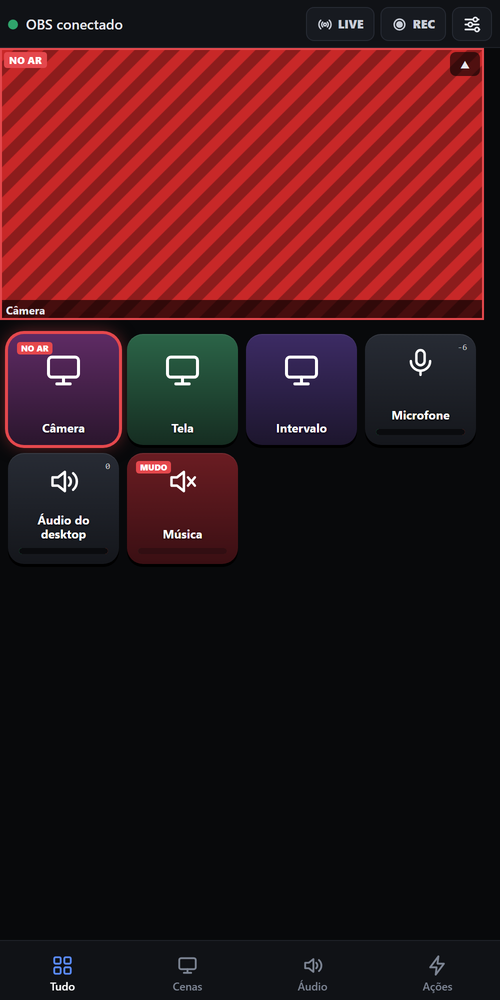
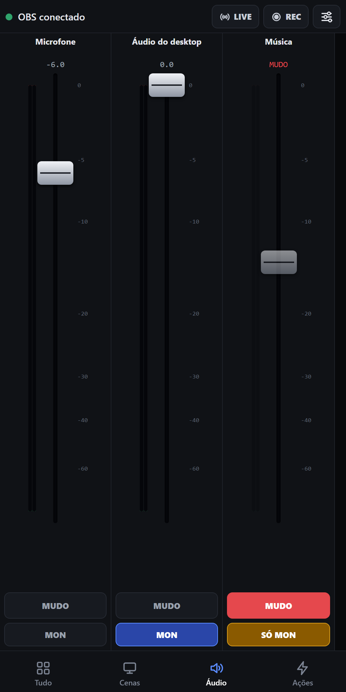
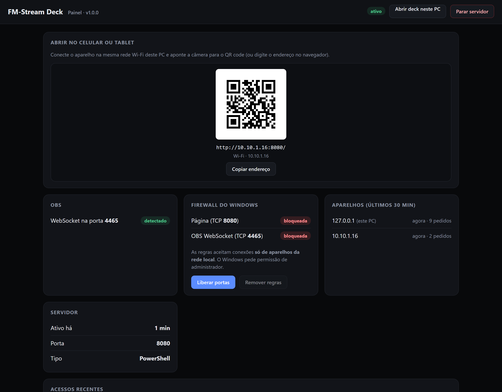

<div align="center">

# 🎛️ FM-Stream Deck

### Free Mobile Stream Deck — turn any phone or tablet into a stream deck for OBS

**Scenes · Audio mixer · Live preview · Chat · Stream & record — right from your browser, no app to install.**

[](LICENSE)


&nbsp;&nbsp;


</div>

---

## Why FM-Stream Deck?

Hardware stream decks are great, but they cost money and you probably already own a drawer full of old phones and tablets. **FM-Stream Deck** is a single HTML file that talks directly to OBS Studio over your local network and turns any device with a browser into a full control surface.

- 💸 **Free and open source** (MIT).
- 📱 **Runs in the browser** — nothing to install on the phone or tablet.
- 🦖 **Revives old hardware** — written in plain ES5 with no flexbox/grid dependency, so it runs on **Android 4.4+, old iPads and other old tablets**.
- 🔌 **Zero dependencies, zero build step** — one `obs-deck.html` file with HTML, CSS and JS together.
- 🏠 **100% local** — your devices talk straight to OBS on your network, with no cloud and no accounts.

## ✨ Features

| | |
|---|---|
| 🎬 **Scenes** | One tap switches scenes. The live scene is highlighted. **Studio Mode** shows Preview + Program and a Transition key. |
| 🖼️ **Live scene preview** | Screenshot of the current scene at the top (1 fps by default, configurable). It refreshes **instantly when the scene changes**. In Studio Mode it shows Preview and Program side by side. It spans the full width on phones and can be collapsed. |
| 🎚️ **Audio mixer** | A mixing-console view with **vertical faders**, stereo **level meters**, **MUTE** and **MON** (audio monitoring on/off) per source. Faders use relative drag like real hardware, so the volume never jumps to your finger. |
| 🔴 **Stream & Record** | Always-visible header buttons with clear live/recording/paused states and confirmations. |
| ⚡ **Actions** | Studio Mode, Transition, Pause/Resume recording, Replay Buffer (start/save) and Virtual Camera. |
| ✂️ **Twitch clips** | A **CLIP** key creates a clip of your live stream in one tap; long-press opens the last clip. You sign in once per device with Twitch's device code (enter a short code at twitch.tv/activate), so no server or HTTPS is needed. Tokens refresh automatically. |
| 💬 **Live chat** | **Twitch** (anonymous, with emotes and badges), **YouTube** or any embeddable chat URL. On phones the chat sits **below the deck** with a draggable divider; on wide screens it is a side column. |
| 📐 **Stream Deck layout** | Auto grid or 3×2, 5×3, 4×4, 8×4. Paging with arrows or swipe. Long-press for secondary actions. |
| 🖥️ **Management panel** | A dashboard on the PC with **QR codes** for each network address, OBS detection, firewall status with one-click rules, connected devices and an access log. |
| 🔐 **Password auth** | Full obs-websocket v5 authentication with a pure-JS SHA-256, so it works without HTTPS. |

<div align="center">

</div>

## 🚀 Quick start

### 1. Enable the WebSocket server in OBS
OBS Studio **28 or newer** → **Tools → WebSocket Server Settings** → check **Enable WebSocket server**.
Click **Show Connect Info** if you want to see the port (default `4455`) and password.

### 2. Start the local server on your PC (Windows)
[Download the latest release](https://github.com/yurihoraguti/FM-Stream-Deck/releases/latest) (or clone the repository) and **double-click `FM-Stream Deck.bat`**.

```bash
git clone https://github.com/yurihoraguti/FM-Stream-Deck.git
```

- The **management panel** opens in your browser.
- Click **Liberar portas** (allow ports) once to create the Windows Firewall rules. Windows asks for administrator permission.
- **Scan the QR code** with your phone, or type the address shown (for example `http://192.168.0.10:8080/`).

The link already points the deck to the OBS running on that PC, so it connects right away. Enter the OBS password in ⚙️ Settings if you have one.

> **Tip:** add the page to your home screen for a full-screen, app-like experience.

### Not on Windows?
Any static web server on the OBS machine works, as long as it serves the page over **plain `http://`** on your local network:

```bash
python -m http.server 8080
```

Then open `http://<PC-IP>:8080/obs-deck.html?host=<PC-IP>` on your phone.

## ⚙️ Configuration

Everything is configured in the in-app **Settings** (⚙️) and saved on each device. You can also pre-fill settings with URL parameters, which is handy for bookmarks or for setting up several devices:

| Parameter | Example | Description |
|---|---|---|
| `host` | `host=192.168.0.10` | Address of the PC running OBS |
| `port` | `port=4455` | obs-websocket port |
| `pass` | `pass=secret` | obs-websocket password (it stays in the URL, so avoid sharing such links) |
| `layout` | `layout=5x3` | `auto`, `3x2`, `5x3`, `4x4` or `8x4` |
| `page` | `page=audio` | Start page: `all`, `scenes`, `audio` or `actions` |
| `twitch` | `twitch=yourchannel` | Show this Twitch channel's chat |
| `youtube` | `youtube=VIDEO_ID` | Show the chat of this YouTube live |
| `chatmode` | `chatmode=tab` | `split` (chat below the deck) or `tab` (separate tab) |

Example: `http://192.168.0.10:8080/obs-deck.html?host=192.168.0.10&twitch=yourchannel&page=scenes`

### Server options

```bat
"FM-Stream Deck.bat" -Port 8080 -ObsPort 4455 -NoPanel -NoFirewall
"FM-Stream Deck.bat" -RemoveFirewall
```

| Option | Description |
|---|---|
| `-Port` | Web server port (default `8080`; tries the next 10 ports if it is busy) |
| `-ObsPort` | OBS WebSocket port used for the links, OBS detection and firewall rule (default `4455`) |
| `-NoPanel` | Don't open the management panel automatically |
| `-NoFirewall` | Don't check or change the firewall |
| `-RemoveFirewall` | Delete the firewall rules created by FM-Stream Deck and exit |

## 🧠 How it works

```
┌──────────────┐   http://PC-IP:8080   ┌──────────────────────────┐
│ Phone/Tablet │ ────────────────────▶ │ FM-Stream Deck server    │  serves obs-deck.html
│  (browser)   │                       │ (PowerShell)             │  + panel on localhost
│              │   ws://PC-IP:4455     ├──────────────────────────┤
│              │ ────────────────────▶ │ OBS Studio               │  obs-websocket v5
└──────────────┘                       └──────────────────────────┘
          everything stays inside your local network
```

The page connects **directly** to obs-websocket (`ws://`). The local server only serves the static page and the management panel.

### Why can't I just host it on GitHub Pages?
OBS only accepts **unencrypted** `ws://` connections. Browsers block `ws://` connections from **HTTPS** pages (mixed content), and they increasingly restrict public websites from reaching devices on your local network. Serving the page from the OBS PC over `http://` avoids both problems and also works on old devices.

## 🔒 Security notes

- The firewall rules only accept connections from your **local subnet** (`remoteip=localsubnet`), so nothing is exposed to the internet.
- The management panel and its API only answer requests **from the PC itself** (loopback with a `localhost` Host header). Actions require `POST` with a custom header, which blocks cross-site requests from other websites.
- The web server only serves page assets from the project folder. It blocks path traversal and does not serve scripts, Markdown or executables.
- obs-websocket traffic is **not encrypted**. Use it on networks you trust, and for remote access prefer a VPN such as Tailscale or ZeroTier instead of opening ports on your router.

## 🛡️ Privacy

FM-Stream Deck has **no telemetry, analytics or accounts**. The program does not transfer information to other systems unless you ask it to:

- The web server only listens on your local network. It serves the deck page and talks to OBS Studio on your own PC.
- The deck connects only to the OBS WebSocket address you configure.
- If **you** enable a chat source, the deck connects to that service: Twitch chat (`irc-ws.chat.twitch.tv`, anonymous read-only, plus emote images from `static-cdn.jtvnw.net`), YouTube live chat, or the URL you provide.
- If **you** connect a Twitch account for clips, the deck signs in with Twitch's device code flow (`id.twitch.tv`). It calls the Twitch API (`api.twitch.tv`) only when you press the CLIP key, and the only permission it requests is `clips:edit`. The token is stored only in that device's browser, and **Desconectar** removes and revokes it.
- Settings are stored only in each device's browser (`localStorage`).

## 🧹 Uninstall

Nothing is installed. The server can add two inbound Windows Firewall rules, limited to your local subnet, only after you confirm and approve the Windows administrator prompt. To remove them, click **Remover regras** in the management panel or run `"FM-Stream Deck.bat" -RemoveFirewall`. Then delete the folder.

## 🛠️ Standalone executable (not shipped yet)

`server/FMStreamDeck.cs` is a single-file C# version of the server with the same features and the same panel. It compiles with the C# compiler that ships with Windows (`server\build.bat`), and CI compiles it on every push.

It is **not included in releases for now**. Windows 11 Smart App Control blocks unsigned executables, and a signed build needs a paid code-signing certificate. Use `FM-Stream Deck.bat`, which does exactly the same thing and runs on any Windows 10/11.

## 📁 Project structure

```
├── obs-deck.html          # the deck (single file: HTML + CSS + ES5 JS)
├── FM-Stream Deck.bat     # double-click launcher (Windows)
├── server/
│   ├── server.ps1         # local web server + management panel API (PowerShell 5.1+)
│   ├── panel.html         # management panel (QR codes, firewall, devices, log)
│   ├── FMStreamDeck.cs    # same server as a standalone .exe (not shipped yet, unsigned)
│   └── build.bat          # compiles the .exe
├── docs/                  # screenshots
└── .github/workflows/     # CI: compile check, package and release
```

## 🧩 Compatibility

| | |
|---|---|
| **OBS Studio** | 28+ (obs-websocket v5, built in) |
| **Devices** | Any modern browser, plus Android 4.4+ (Chrome/WebView) and old iPads/iPhones (Safari) |
| **Server** | Windows 10/11 (PowerShell 5.1, built in). Any OS with a static web server. |
| **UI language** | Portuguese (pt-BR). Translations are welcome! |

## 🗺️ Roadmap

- [ ] Editable deck: reorder, rename, colors, icons and folders
- [ ] Keys to show/hide scene sources and trigger hotkeys
- [ ] English UI and i18n
- [ ] Auto fades (tap to fade a source in/out)
- [ ] Pause recording from the header
- [x] Twitch clips

## 🤝 Contributing

Issues and pull requests are welcome! Please keep the deck **dependency-free and ES5-compatible**, because supporting old devices is a core goal. You can check the script with:

```bash
npm install acorn
node -e "const h=require('fs').readFileSync('obs-deck.html','utf8');require('acorn').parse(h.split('<script>')[1].split('</script>')[0],{ecmaVersion:5});console.log('ES5 OK')"
```

## 📄 License

[MIT](LICENSE) © Yuri Horaguti

---

<sub>FM-Stream Deck is an independent project. It is not affiliated with, endorsed by or sponsored by Elgato/Corsair ("Stream Deck") or the OBS Project. OBS Studio is a trademark of its respective owners.</sub>
